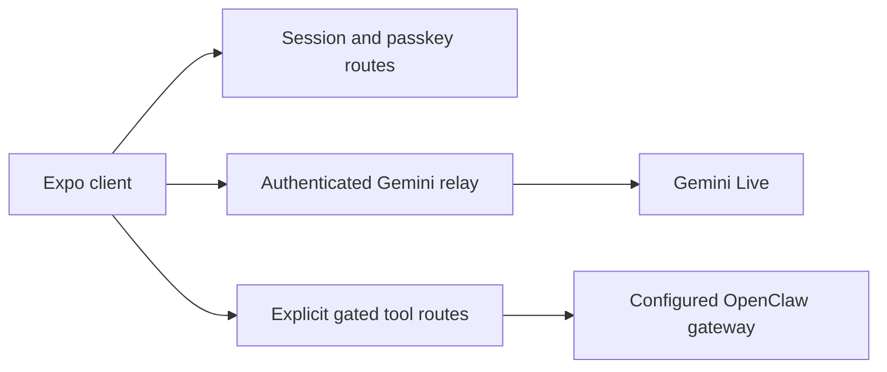

# Current architecture

The Expo Router client connects to the Node bridge. The bridge authenticates browser sessions and relays `/gemini` WebSockets to Gemini Live. Explicit OpenClaw tool routes are loaded only when `ENABLE_OPENCLAW_ROUTES=true`; the offline test path never loads a gateway.

| Boundary | Implementation |
|---|---|
| Live session orchestration | [app/live.tsx](app/live.tsx) |
| Shared visual states | [components/LiveVisuals.tsx](components/LiveVisuals.tsx) |
| PCM encoding, downsampling and level calculation | [src/audio/pcm.ts](src/audio/pcm.ts) |
| Bridge transport, origin checks and sessions | [proxy.mjs](proxy.mjs) |
| Bounded file-backed memory | [server/memory-store.mjs](server/memory-store.mjs) |
| Explicit WebSocket rejection status | [server/upgrade-auth.mjs](server/upgrade-auth.mjs) |
| Browser credential helpers | [src/services/passkey.ts](src/services/passkey.ts) |

Use Node 24. Run `npm ci`, `npm run typecheck`, `npm test`, and `npm run build:web`. Set your own bridge configuration from `.env.example`. The bridge binds to loopback by default; set `HOST` explicitly when deploying behind an appropriate secure origin. Native clients require their own `EXPO_PUBLIC_PROXY_URL`; the fallback is local development, not a named remote machine. Never place privileged keys in `EXPO_PUBLIC_*` variables.

`/demo` is an authored, read-only interface walkthrough using the shared visual components. Its buttons change preview states locally. It does not request a microphone or connect to Gemini. CI tests the actual bridge on an ephemeral loopback port with providers disabled, then exports the web client. Native audio, live tool success, latency, passkey registration/authentication and recovery still need deployment-specific end-to-end acceptance with the account holder. Existing passkey and session routes remain intact.

Earlier architecture and machine-specific notes are in [docs/history](docs/history/README.md).
