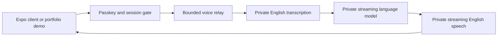

# Current architecture

The Expo Router client and portfolio demo use authenticated WebSockets. The default bridge provider is Spark: English speech recognition, streamed LLM text and streaming Magpie speech with Aria. The existing `/gemini` path is retained for client compatibility; Spark sessions do not contact Google. The previous Gemini provider remains an explicit rollback option.

| Boundary | Implementation |
|---|---|
| Live session and playback | [app/live.tsx](app/live.tsx) |
| Shared visual states | [components/LiveVisuals.tsx](components/LiveVisuals.tsx) |
| PCM encoding and downsampling | [src/audio/pcm.ts](src/audio/pcm.ts) |
| Origin checks, authentication and relay | [proxy.mjs](proxy.mjs) |
| Transcription, streamed generation and cancellation | [server/spark-voice.mjs](server/spark-voice.mjs) |
| Demo's private bridge adapter | [demo/engine-adapter.mjs](demo/engine-adapter.mjs) |
| Browser credential helpers | [src/services/passkey.ts](src/services/passkey.ts) |

Use compatible Node 24.x or 26.x. Run `npm ci`, `npm run typecheck`, `npm run check:sdk`, `npm test`, `npm audit --audit-level=low` and `npm run build:web`. Server configuration and native migration details are in [SPARK-VOICE.md](docs/SPARK-VOICE.md). Bind development services to loopback. Use a stable secure origin and matching RP ID for deployment. Never put privileged credentials in `EXPO_PUBLIC_*` variables.

The separate portfolio demo preserves its authored text replay and adds a passkey-protected real conversation panel. Speech capture starts only on request. Its scoped server identity contacts the private relay; browser bundles contain no service credentials. Spark sessions support text and voice, with no vision or tool execution. Optional account integrations remain separate and are disabled in the isolated acceptance instance.

Acceptance includes real machine-authenticated streaming speech and recorded English input through existing inference APIs, plus browser inspection of the exported app and protected demo. This does not substitute for holder passkey enrollment, real sign-in, second-key recovery, physical microphone/playback or native-device acceptance. No Spark service, configuration or production dataset was changed. Earlier architecture is retained in [docs/history](docs/history/README.md).
