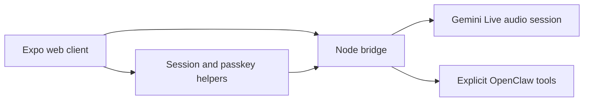

# M8 Live Voice Assistant

A web-first voice assistant connecting an Expo client, Gemini Live audio sessions, and explicit OpenClaw-backed tools.

This repository exposes application source for architecture review: realtime audio transport, client state, a backend bridge, and browser authentication helpers.

## Interactive English demo

[Run the interactive demo](demo/README.md) to explore the approved product interface, local example workflows and downloadable outputs. The isolated demo uses English throughout and preserves the original application below. See its README for the exact example boundaries and passkey acceptance status.

## Demonstration


See the [reproducible walkthrough and its validation scope](docs/DEMO.md).

## Project direction and use

[Kenneth Yepez](https://github.com/kennethyepez) directs product requirements, architecture, integration, validation, and deployment. AI coding agents implement code under his direction.

See [use and licensing](LICENSE.md), [contributing](CONTRIBUTING.md), and [security reporting](SECURITY.md).

## Architecture



The audio transport and tool execution have separate roles. OpenClaw handles tool/session integration rather than carrying microphone audio.

| Area | Source |
| --- | --- |
| Main conversation interface | [app/live.tsx](app/live.tsx) |
| Bridge, realtime relay, and API routes | [proxy.mjs](proxy.mjs) |
| Backend URL and client connection configuration | [appConfig.ts](src/services/appConfig.ts) |
| Session lifecycle | [bridgeSession.ts](src/services/bridgeSession.ts) |
| Browser passkey helpers | [passkey.ts](src/services/passkey.ts) |
| OpenClaw integration | [openclaw.ts](src/services/openclaw.ts) |
| Client state | [session store](src/stores/session.ts) |

The bridge includes explicit environment configuration, restricted origins, signed session cookies, and passkey registration/authentication routes. The presence of those routes is not a deployment security certification or proof of a completed authenticator flow.

## Explore and build the web client

Review [package.json](package.json), [.env.example](.env.example), and the bridge configuration before starting a local instance.

```bash
npm ci
npm run build:web
```

The build generates the excluded `dist/` directory. With your own backend configuration in place, `npm run serve` starts the Node bridge and serves the exported client; `npm run web` starts the Expo web development server.

Configure `EXPO_PUBLIC_PROXY_URL` for your own bridge before building. Client-visible `EXPO_PUBLIC_*` values are embedded in the bundle, so keep privileged credentials on the server. Gemini API credentials belong in the bridge environment.

A functional voice session also needs microphone permission, a compatible browser and secure origin, working bridge authentication, and your own Gemini access. OpenClaw routes require a separately configured gateway and explicit enablement. Live provider use can incur charges.

## Implementation scope

The client source includes web microphone capture with PCM downsampling, audio playback, text input, tool calls, and native audio/camera paths. The [current architecture](ARCHITECTURE.md) explains transport, authentication, module boundaries, and the offline checks.

Latency, reconnect recovery, tool reliability, and passkey enrollment/recovery still need a recorded end-to-end demonstration for the chosen deployment. No performance benchmark is claimed here.

Earlier plans and diagnostic scripts are preserved under [docs/history](docs/history/README.md).

## Public branches

- `main`: primary application source snapshot.
- `codex/spark-recovery-20261119`: recovered development source snapshot.

Both branches began as fresh, sanitized snapshots. Generated bundles and earlier private development history are excluded. The original repository and its recovery history remain private.

## Engineering decisions to examine

- Separate realtime audio from tool orchestration.
- Provision access from the bridge instead of embedding a server API key in the web client.
- Keep tool endpoints explicit and gated.
- Treat web and native mobile audio as distinct implementation and validation paths.

These sources support a discussion of implementation choices; they do not establish the status of any live service.

## Reviewed delivery

See the [delivery workflow](docs/DELIVERY.md) for acceptance criteria, commit boundaries, identified AI/human review, protected integration, and source provenance.
