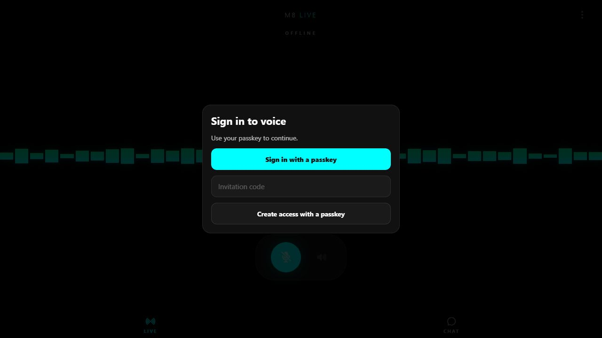
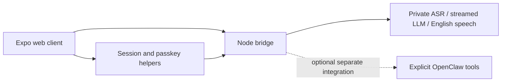

# M8 Live Voice Assistant

An English voice assistant connecting an Expo 58 client to private speech recognition, a streamed LLM response, and native streaming speech. The Node bridge keeps provider credentials on the server and supports passkey access.

This repository exposes application source for architecture review: realtime audio transport, client state, a backend bridge, and browser authentication helpers.

## See the workspace

The original Expo conversation screen, with its green/cyan audio spectrum and glass microphone dock, connected to the private English voice engine and workspace passkeys.



[Open the English workspace](https://voice.kennethyepez.com) · [Run locally](demo/README.md) · [Desktop and phone views](docs/PRODUCT.md) · [Engineering case](docs/CASE-STUDY.md) · [Watch the workspace recording](https://raw.githubusercontent.com/m8appz-dotcom/m8-live-voice-assistant-public/main/docs/examples/workspace-walkthrough.mp4)

The captures show the restored screen in an isolated browser preview. The retained recording shows the previous authored example workflow, available at [Saved workspace](https://voice.kennethyepez.com/workspace/). It does not demonstrate the restored screen's live microphone or a human passkey ceremony.

Returning users sign in with their existing passkey at the same HTTPS origin. New private accounts require an administrator invitation and a passkey. Voice starts explicitly from the microphone control and uses the bounded private engine. Settings retains access to the previous saved workspace; its data is not migrated or overwritten. The hosted export uses `/auth/` and `/engine/live`; native and separately operated bridge clients retain their existing paths. See [hosting, recovery and limits](demo/HOSTING.md).

## Project direction and use

[Kenneth Yepez](https://github.com/kennethyepez) directs product requirements, architecture, integration, validation, and deployment. AI coding agents implement code under his direction.

See [use and licensing](LICENSE.md), [contributing](CONTRIBUTING.md), and [security reporting](SECURITY.md).

## Architecture



The audio transport and tool execution have separate roles. OpenClaw handles tool/session integration rather than carrying microphone audio.

| Area | Source |
| --- | --- |
| Main conversation interface | [app/live.tsx](app/live.tsx) |
| Bridge, realtime relay, and API routes | [proxy.mjs](proxy.mjs) |
| Backend URL and client connection configuration | [appConfig.ts](src/services/appConfig.ts) |
| Session lifecycle | [bridgeSession.ts](src/services/bridgeSession.ts) |
| Browser passkey helpers | [passkey.ts](src/services/passkey.ts) |
| OpenClaw integration | [openclaw.ts](src/services/openclaw.ts) |
| Client state | [session store](src/stores/session.ts) |

The bridge includes explicit environment configuration, restricted origins, signed session cookies, and passkey registration/authentication routes. The presence of those routes is not a deployment security certification or proof of a completed authenticator flow.

## Explore and build the web client

Use Node.js 24.3+ in the 24.x LTS line or Node.js 26.x. Odd-numbered Node 25 is outside the SDK 58 supported range.

Review [package.json](package.json), [.env.example](.env.example), and the bridge configuration before starting a local instance.

```bash
npm ci
npm run build:web
```

The build generates the excluded `dist/` directory. With your own backend configuration in place, `npm run serve` starts the Node bridge and serves the exported client; `npm run web` starts the Expo web development server.

Configure `EXPO_PUBLIC_PROXY_URL` for your own bridge before building. Client-visible `EXPO_PUBLIC_*` values are embedded in the bundle, so keep privileged credentials on the server. Speech and model credentials belong only in the bridge environment. The default voice provider is Spark; Gemini remains an explicit legacy rollback option.

A functional voice session also needs microphone permission, a compatible browser and secure origin, working bridge authentication, and configured private inference services. OpenClaw routes require a separately configured gateway and explicit enablement. No external model or voice provider is called by the Spark pathway.

## Implementation scope

The client source includes web microphone capture with PCM downsampling, audio playback, text input, tool calls, and native audio/camera paths. The [current architecture](ARCHITECTURE.md) explains transport, authentication, module boundaries, and the offline checks.

See [the private voice pathway and acceptance limits](docs/SPARK-VOICE.md). Recorded local tests exercised real text-to-voice and recorded-audio-to-voice requests. Physical holder passkey enrollment/recovery and microphone/device acceptance remain pending; they are not inferred from machine tests.

Earlier plans and diagnostic scripts are preserved under [docs/history](docs/history/README.md).

## Public branches

- `main`: primary application source snapshot.
- `codex/spark-recovery-20261119`: recovered development source snapshot.

Both branches began as fresh, sanitized snapshots. Generated bundles and earlier private development history are excluded. The original repository and its recovery history remain private.

## Engineering decisions to examine

- Separate realtime audio from tool orchestration.
- Provision access from the bridge instead of embedding a server API key in the web client.
- Keep tool endpoints explicit and gated.
- Treat web and native mobile audio as distinct implementation and validation paths.

These sources support a discussion of implementation choices; they do not establish the status of any live service.

## Reviewed delivery

See the [delivery workflow](docs/DELIVERY.md) for acceptance criteria, commit boundaries, identified AI/human review, protected integration, and source provenance.
