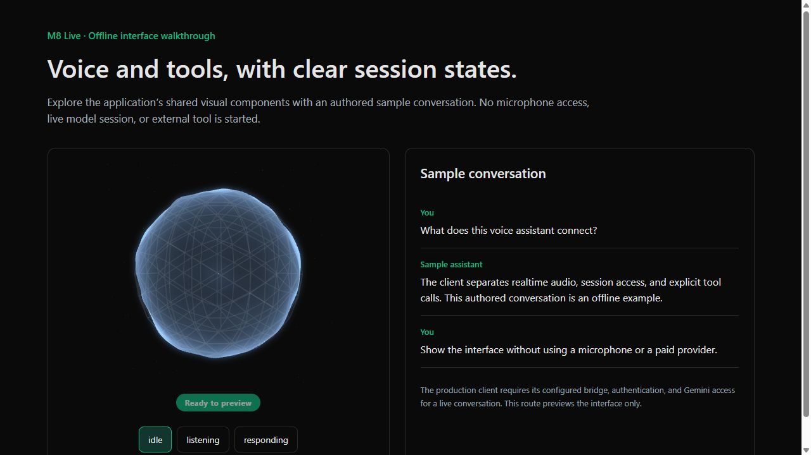

# Voice interface state walkthrough



## Reproduce

Node 24. The bridge binds to loopback by default. Keep provider keys empty and OpenClaw routes disabled for the offline walkthrough.

Use an isolated checkout and environment.

```bash
npm ci
npm run typecheck
npm test
npm run build:web
npm run serve
```

## What the example establishes

Open /demo on the local bridge. Its Idle, Listening, and Responding buttons change the actual shared visual components using an authored sample conversation. This path requests no microphone and makes no live Gemini or OpenClaw call. It is an interface walkthrough, not a voice-quality or latency benchmark. CI separately tests PCM handling, memory persistence and secret refusal, HTTP authentication, origin rejection, and WebSocket authentication. Live voice, native audio, authenticator enrollment and recovery need deployment-specific acceptance with the holder.

The screenshot records the visible output of this workflow. It does not establish behavior outside the stated scope. Generated evidence and source examples are preserved alongside the walkthrough; current CI runs provide commit-specific checks.
