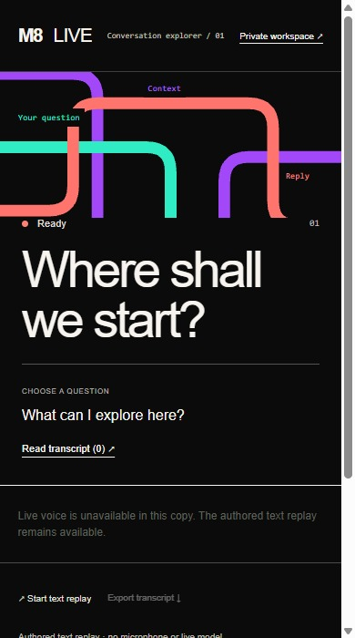

# M8 Live Voice Assistant — product review

An English conversation workspace with a private speech and model relay.

## Desktop

## Phone

## Try it

Follow [local setup](../demo/README.md). Guest exploration uses authored examples. The [engine setup](../demo/ENGINES.md) explains which actions use the repository engine and which need private provider configuration. Private workspace access uses the existing passkey flow.

These are original browser captures of the current interface. No image was cropped, resized or regenerated. The CSS maintenance change preserves the selected composition and removes the other products’ styles.

[Watch the workspace recording](examples/workspace-walkthrough.mp4). It contains actual browser frames with idle waits shortened and no narration. It demonstrates the authored workflow; it does not record a live provider or a completed human authentication flow.
