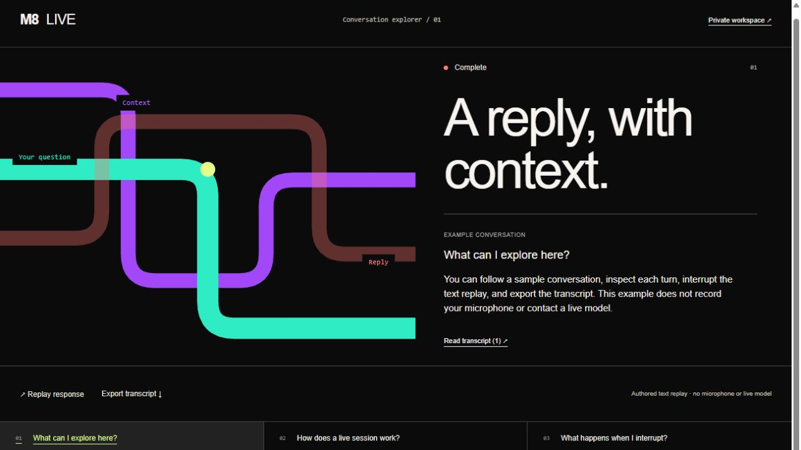

# M8 Live Voice Assistant — product review

An English conversation workspace with a private speech and model relay.

## Desktop

## Phone

## Try it

Open [the English HTTPS workspace](https://voice.kennethyepez.com) or follow [local setup](../demo/README.md). Guest exploration uses authored examples. Live conversation requires a passkey and available session capacity. The [engine setup](../demo/ENGINES.md) explains private operator configuration.

These original browser captures show the published HTTPS interface. The phone view shows its transcript and live access section. No image was cropped, resized or regenerated.

[Watch the workspace recording](examples/workspace-walkthrough.mp4). It contains actual browser frames with idle waits shortened and no narration. It demonstrates the authored workflow; it does not record a live provider or a completed human authentication flow.
