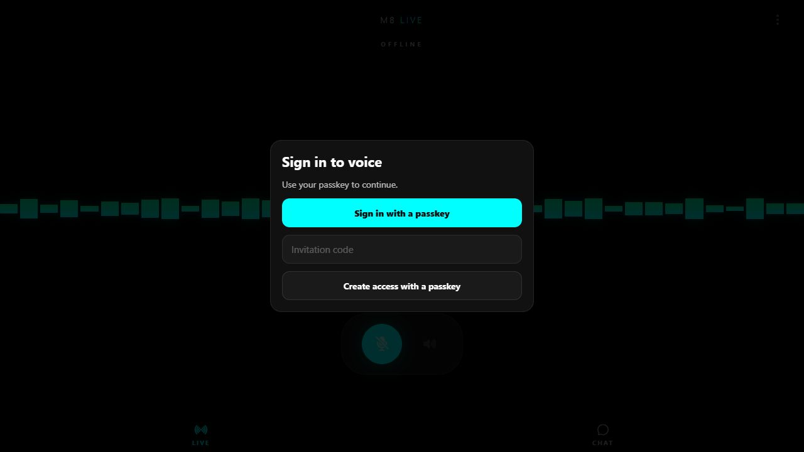
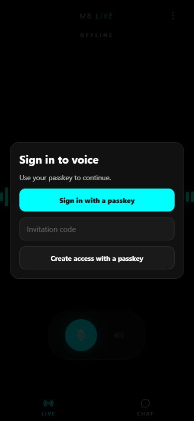

# M8 Live Voice Assistant — product review

The original Expo screen with its green/cyan audio spectrum, Live/Chat views and microphone dock. The hosted export connects that screen to the existing private English voice engine and WebAuthn workspace access.

## Desktop

## Phone

## Try it

Open [M8 Live](https://voice.kennethyepez.com). Sign in with the existing passkey, then use the microphone control to connect. Chat supports typed turns; the speaker control mutes spoken replies. New private accounts require an administrator invitation and passkey. Live conversations require available session capacity. Settings retains the [previous saved workspace](https://voice.kennethyepez.com/workspace/), without moving or overwriting saved data.

These unmodified browser captures show the restored screen's access gate in an isolated preview. They establish desktop/phone rendering, not a completed authentication or acoustic test. The spectrum component and native visual source are preserved. Holder sign-in, recovery and physical microphone/playback acceptance on this restored screen must be checked at the final secure origin.

[Watch the previous workspace recording](examples/workspace-walkthrough.mp4). This retained historical recording shows the authored replay now available under `/workspace/`. It does not show the restored screen or a completed human authentication flow.
